# CELESTIA — System Architecture & Technical Specification

CELESTIA is an enterprise-grade, deterministic celebration and event planning system built with a **FastAPI** backend and a **Next.js (App Router)** frontend. It converts natural-language planning ideas into mathematically verified financial ledgers, Critical Path schedules, and authenticated operational workflows.

---

## 1. System Architecture Overview

```mermaid
flowchart TD
    subgraph Browser ["Frontend (Next.js 16 / React 19 / TanStack Query)"]
        Landing["Marketing Landing (/)"]
        AuthPages["Auth Routes (/login, /register)"]
        AppShell["AppShell (Sidebar + TopBar)"]
        Overview["Overview Bento (/events/:id)"]
        BudgetUI["Budget & What-If (/events/:id/budget)"]
        TimelineUI["Timeline & CPM (/events/:id/timeline)"]
        VendorsUI["Vendors & Quotes (/events/:id/vendors)"]
        ApprovalsUI["Review & Approvals (/events/:id/approvals)"]
        BlueprintUI["Printable Blueprint (/events/:id/blueprint)"]
    end

    subgraph Security ["Security & Transport Boundary"]
        HttpOnly["HttpOnly Secure SameSite Cookies"]
        CSRF["Double-Submit X-CSRF-Token"]
        RateLimiter["IP/Sliding-Window Rate Limiter"]
        AuditMiddleware["Structured Logging & Request-ID"]
    end

    subgraph Backend ["Backend API (FastAPI / SQLAlchemy / Pydantic v2)"]
        AuthRouter["Auth & Account Lifecycle"]
        EventRouter["Events & Configuration"]
        BudgetRouter["Budget & What-If Engine"]
        TaskRouter["CPM Scheduling Engine"]
        VendorRouter["Vendor Intelligence & Matrices"]
        ApprovalRouter["Two-Phase Proposal Pipeline"]
        AIGateway["AI Gateway (Input Sanitization & Circuit Breaker)"]
    end

    subgraph Storage ["Persistent Storage"]
        DB[(PostgreSQL / SQLite Database)]
        Alembic["Alembic Versioned Migrations"]
    end

    Browser -->|Encrypted Cookies & CSRF Header| Security
    Security --> Backend
    Backend --> Storage
```

---

## 2. Core Architectural Principles

### 2.1 Deterministic Accounting (Zero Float Drift)
- **Integer Paise Representation**: All monetary quantities (`total_budget_minor`, `allocated_amount_minor`, `actual_amount_minor`, `quoted_amount_minor`) are stored and computed strictly as integer minor units ($1\text{ INR} = 100\text{ paise}$).
- **Allocation Basis Points**: Category allocations use integer basis points ($100.00\% = 10,000\text{ bps}$).
- **Reconciliation Invariant**:
  $$\text{Total Budget} = \text{Allocated Minor} + \text{10% Contingency Reserve} + \text{Unallocated Minor}$$
  Guaranteed down to exactly 1 paisa.
- **Formatting Boundary**: Numbers are formatted into Indian Lakh/Crore strings (`₹15,00,000.00`) only at the UI display layer via `src/lib/money.ts`.

### 2.2 Critical Path Method (CPM) Execution Scheduling
- **DAG Execution**: Event timelines are represented as Directed Acyclic Graphs of milestones and tasks.
- **Two-Pass Algorithm**:
  - Forward Pass calculates Early Start ($ES$) and Early Finish ($EF$).
  - Backward Pass calculates Late Start ($LS$) and Late Finish ($LF$).
  - Total Float (Slack) determines criticality ($\text{Slack} = 0 \implies \text{Critical Path}$).
- **Cycle & Disconnection Guards**: Graph integrity is validated using Kahn's topological sort algorithm to prevent scheduling deadlocks.

### 2.3 Two-Phase Human-in-the-Loop Proposal Engine
- **Autonomy Levels**:
  1. *Suggest (Advisory)*: AI recommendations produce no persistent state changes.
  2. *Draft (Recommended)*: AI proposes structured changes (diff summary + JSON patch) staged in `approvals` table.
  3. *Approve (Direct)*: High-confidence changes staged directly into audit trail.
- **Safe Rollback**: Approved changes maintain before-and-after snapshots allowing single-click state rollback.

---

## 3. Frontend Architecture

### 3.1 Modular Feature Organization
The frontend codebase follows a strict feature-folder architecture under `frontend/src/`:
- `src/features/overview/`: Bento dashboard, high-level KPI cards.
- `src/features/budget/`: Deterministic budget table, debounced What-If simulation engine.
- `src/features/timeline/`: CPM milestone list, critical-path indicator, slack indicators.
- `src/features/vendors/`: Vendor directory, quotation comparison matrix.
- `src/features/approvals/`: Human-in-the-loop review queue, structured diff viewer.
- `src/features/planner/`: Context-aware celebration intelligence assistant.
- `src/features/settings/`: Cultural preferences, autonomy circuit breaker, event lifecycle.

### 3.2 Design System Tokens & WCAG AA Compliance
- **Zero Raw Hex**: All styling is driven by semantic CSS custom variables (`--canvas`, `--canvas-card`, `--ink-primary`, `--ink-muted`, `--brand-teal`, `--brand-marigold`, `--status-danger`, `--border-subtle`).
- **Contrast Ratios**: Body text meets $\ge 7:1$ contrast against light canvas; interactive badges meet $\ge 4.5:1$.
- **Accessible Shell**: Includes skip-to-content anchor, keyboard-navigable focus rings, and explicit `aria-label` attributes.

### 3.3 Strict Type Safety
- **OpenAPI Schema Generation**: API types are auto-generated from backend `/openapi.json` into `src/lib/api/schema.ts` via `openapi-typescript`.
- **Zero `any`**: Strictly zero implicit or explicit `any` across the entire codebase (`@typescript-eslint/no-explicit-any = error`).
- **Exact Optional Property Types**: Enforced via `tsconfig.json` (`exactOptionalPropertyTypes: true`, `noUncheckedIndexedAccess: true`).

---

## 4. Backend & Security Architecture

### 4.1 Transport & Session Security
- **HttpOnly Cookies**: Session tokens are isolated from browser JavaScript.
- **Fail-Closed Configuration**: Startup validation rejects missing, default, or weak `SECRET_KEY` in production environments.
- **Sliding-Window Rate Limiter**: Per-IP sliding-window limits protect sensitive endpoints (`/auth/login`, `/auth/register`, `/ai/extract-requirements`).
- **Request Tracing**: `X-Request-ID` is assigned to each incoming request and propagated to structured JSON logs.

### 4.2 Database Migrations & Versioning
- **Alembic Versioning**: Schema evolutions are tracked through reproducible migration scripts in `backend/alembic/versions/`.
- **Optimistic Concurrency**: `version` columns on `tasks`, `budget_categories`, and `expenses` prevent dirty writes and race conditions (returning `409 Conflict` on stale updates).
- **Idempotency Keys**: Mutating operations accept `Idempotency-Key` headers scoped per user and endpoint, guaranteeing safe network retries.

---

## 5. Verification Gates

| Gate | Tool / Command | Target Standard | Status |
|---|---|---|---|
| Frontend Lint | `npm run lint --prefix frontend` | 0 errors | **PASS** |
| Frontend Type Check | `npx tsc --noEmit` | 0 errors, strict flags | **PASS** |
| Code Formatting | `npx prettier --check` | 100% formatted with LF | **PASS** |
| Type Purity | `grep -rE ": any\|<any>\|as any"` | 0 matches in frontend/src | **PASS** |
| Design Tokens | `grep -rE "#[0-9a-fA-F]{3,8}"` | 0 raw hex in components/features | **PASS** |
| Backend Lint & Format | `python -m ruff check backend/app` | 0 errors | **PASS** |
| Backend Static Typing | `python -m mypy backend/app` | Strict typing, 0 errors | **PASS** |
| Test Suite | `python -m pytest backend/tests -q` | 125 passed, 0 failures | **PASS** |
| Security Probe | `python tools/security_probe.py` | 0 vulnerabilities found | **PASS** |

